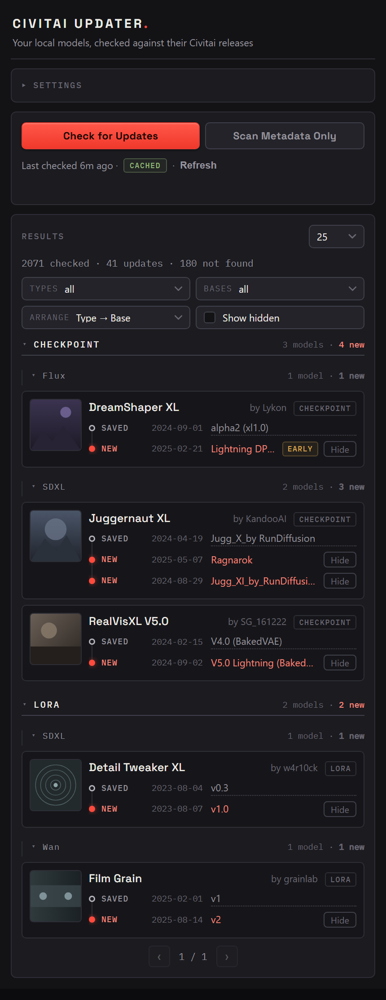

# Civitai Updater

A ComfyUI sidebar panel that checks the models on your disk against their
Civitai releases, and tells you which ones have moved on without you.

It reads what you already have — model files and their `.civitai.info`
sidecars — identifies each one by SHA256 hash, and lists only the models with
a newer release. Checking downloads no model and touches no model file: the
panel links you to the release page and gets out of the way. It only writes
`.civitai.info` and `.preview.png` sidecars next to your models.

The panel can also rename your model files into one scheme, after their
Civitai releases. Files are renamed only when you apply a list you have
reviewed; see [Renaming your library](#renaming-your-library).



## Reading the panel

Every model card is a small ledger of that model's releases. The dot on the
left says where each version stands:

| Dot | Row | Meaning |
| --- | --- | --- |
| ○ | `SAVED` | A version you have on disk. Click the name to copy its file path. |
| ○ | `METADATA` | Tracked from a `.civitai.info` sidecar with no model weights next to it. |
| ● | `NEW` | Published after your newest local version. Click the name to open it on Civitai. |
| ● | `HIDDEN` | A new release you chose to hide. Shown only with **Show hidden** on. |
| ● | `ERROR` | Civitai could not be asked about this model, or refused (removed, needs an API key). The reason is printed under the row. |
| ◌ | `NO MATCH` | Civitai has no release with this file's hash: a merge, a conversion, or never uploaded. |

Red means exactly one thing: a release exists that you do not have. A quiet
card is an up-to-date card. `ERROR` and `NO MATCH` rows are amber and grey, and
they live in the **Issues** view, next to **Updates** above the list.

A new release that costs Buzz to download carries a badge:

- **Buzz · 5d left** (dashed): early access. It becomes free on the date in the
  tooltip.
- **Buzz · always** (solid): the release has no free date.

Civitai's public API says which releases are paid and until when, but not the
price.

Base models are grouped by family, because Civitai records one per version and
the spellings multiply: `Flux.1 D`, `Flux.2 Klein 9B` and `Flux.2 Klein 9B-base`
all file under **Flux**, while every row still prints its exact base. A model
page can carry releases on several base models, so a card is filed under the
base of the release it is headlining. Unrecognised values keep their own name
instead of being swept into a catch-all.

A version counts as **new** when its `publishedAt` date (or `createdAt`, when
`publishedAt` is missing) is later than the newest local version you have of
that model — not by version number, which creators format however they like.

## Installing

1. Put this repo in ComfyUI's `custom_nodes` folder, or install **Civitai
   Updater** from the ComfyUI Registry.
2. Restart ComfyUI.
3. Open **Civitai** in the sidebar.

Windows junction, if you keep the source elsewhere:

```powershell
$src = "C:\path\to\civitai-updater"
$dst = "C:\path\to\ComfyUI\custom_nodes\civitai-updater"
New-Item -ItemType Junction -Path $dst -Target $src
```

Requires Python 3.9+. Pulls in `requests`, `Pillow`, `imageio-ffmpeg` (only
to turn video previews into thumbnails) and `send2trash` (only to move the
renamer's extra copies to the Recycle Bin).

## Using it

- **Check for Updates** — scans your files and compares them with Civitai.
  Results from the previous check stay on screen, marked provisional, and each
  card refreshes in place as its model is re-checked. Stopping the job keeps
  what it had already found.
- **Fetch Missing Metadata** — downloads `.civitai.info` sidecars and preview
  images for models that are missing them. Files that already have metadata are
  skipped and nothing is compared for updates, so it is the cheap way to
  populate names, base models, and thumbnails after adding a batch of models.
  Tick **Refetch metadata that already exists** to re-pull the ones you have.
- Long jobs can be paused, resumed, or stopped, and survive a page reload.
- **Arrange** groups the list two levels deep and sorts within it. The default
  is model type, then base model, sorted A–Z; sort by **Furthest behind** to
  lead with the models that have drifted the most.
- Group headers count what is waiting (`3 models · 4 new`) across the whole
  result set, and collapse to put a type aside. A group that runs past a page
  break repeats its header marked `cont.`
- Results are filterable by model type and base model, paginated (25/50/100),
  and any release you are not interested in can be hidden.
- Click a thumbnail to compare your local preview against the new release.

## Renaming your library

The **Rename** view, next to **Updates** and **Issues**, renames your model
files after their current Civitai releases, in one scheme:

```
creator - title - version [precision] (base)
```

All lowercase, for example `some_artist - watercolor style - v2 (sdxl)` for a
LoRA or `some_studio - photo mix - v3 fp16 (sdxl)` for a checkpoint.

- **creator** is the Civitai uploader. For a re-upload, a conversion or an
  official model it is the model's maker, when the description credits one.
- **title** and **version** come from Civitai's live data, cleaned up: no base
  model names, no "lora", no taglines. A name the creator coined stays as
  written.
- **precision** (`int8`, `fp8`, `bf16`, `q8_0`, …) is given only to
  checkpoints and UNets; LoRAs never get one. It is read from the model file
  itself. A metadata-only entry (a `.civitai.info` with no weights) takes it
  from Civitai's file info instead, and only when the release has a single
  main model file.
- **base** is a short code per base model, such as `sdxl` or `flux1d`. The
  codes are a table, seeded once from the `(tag)` at the end of your existing
  file names, and you can edit it in the Rename view (**Base codes**). A base
  the table does not know gets a suggested code, saved when you apply.

Checkpoints, LoRAs, UNets and embeddings are renamed where they are. Every
file next to the model that shares its name goes along: the `.civitai.info`,
the `.preview.png`, and anything another tool left there.

### The naming model

The cleaning is done by a local text model, run by ComfyUI's built-in
**Generate Text** node. Nothing goes to the cloud and no other app is needed.
Pick the model under **Settings → Civitai Updater → Rename → Naming model**:
any Qwen3, Qwen3.5, Qwen3-VL or Gemma text encoder file in your
`text_encoders` folders that ComfyUI can load. Until a usable naming model is
set, the Rename view offers **Download naming model (9.75 GB)**, which fetches
Comfy-Org's `qwen3.5_9b_int8_convrot.safetensors` into your first
`text_encoders` folder. If that file is already in one of those folders, it is
chosen instead of downloaded again.

The renamer's work goes through ComfyUI's queue like any other prompt, so it
takes turns with your own jobs and shows up in the queue history. A ComfyUI
too old to have Generate Text cannot run the renamer; the view says so.

### Dry run, review, apply

1. **Start dry run.** It asks Civitai about every model and the naming model
   about every title, and lists each old name next to its new name. Nothing on
   disk changes yet. The answers are saved, so a second dry run only asks
   about models that changed. Each model is one card, as in **Updates**: its
   preview, Civitai title and uploader, and one line per file. Click a file's
   name to show it in its folder.
2. **Review.** Rows that need a look come first: a word the naming model could
   not find in Civitai's text, a maker taken from the description, two files
   that would get the same name, two versions or two models by one creator
   that would get the same name or title (the naming model is asked once more
   first), a version whose own name names another base, a new base code. The new
   name is under the current one, with the changed words marked. You can **Edit**
   any part, or **Ask again** to let the naming model name the model afresh on
   the next dry run. The checkbox decides whether a file is renamed: a file you
   untick keeps its name, also in later dry runs, until you tick it again.
3. **Apply selected** renames the ticked rows and moves the extra copies to the
   Recycle Bin.

The same Civitai file saved twice in one folder is listed once as an extra
copy. The copy kept is one with weights, if any, and then the one whose name
matches its Civitai info; a copy saved under the wrong name long ago is the
extra one. It is the line under the copy kept, and starts ticked (its name
struck through) when the copies are the same Civitai file or have the same
stored hash; untick it to keep both. An extra copy goes to
the Recycle Bin with its `.civitai.info` and `.preview.png`, and its weights
only when they are byte-identical to the kept copy's. Any other file of its name
(an archive, a backup) stays where it is.

The naming model gets roughly three in four names exactly right on models it
has not seen before. Read the list before you apply it.

Your edits are remembered per model and win over the naming model on every
later dry run. Applied names are locked: a creator retitling the model on
Civitai does not bring up a new name for files you already renamed, until you
click **Ask again**.

### What is not renamed

The dry run lists these as kept, with the reason:

- Models or releases Civitai no longer serves. Their sidecars do not hold
  enough to rebuild a name from.
- Files whose Civitai match is not the release's main model file, or whose
  Civitai type does not fit the folder (a text encoder in `unet`, say).
- Files kept with **Keep current name** in an earlier version; ticking one renames it after all.

Two kinds are left alone without being listed:

- Files without Civitai metadata: no `.civitai.info` with a model and version
  id, as with merges, conversions and your own trainings. Run **Fetch Missing
  Metadata** first, so every file Civitai knows has one.
- The VAE folder. One VAE serves several base models, and Civitai matches it by
  hash to whoever attached it to their release.

### Before you apply

There is no backwards compatibility. Saved workflows, and images with their
workflow, that use the old names show those LoRAs and models as missing.
Re-pick them.

If ComfyUI stops in the middle of a rename, a journal remembers where it got
to, and the Rename view offers **Finish** or **Undo** on the next start. A file
that already has the new name is never overwritten, and a file Windows has
locked (a model loaded right now) is skipped and reported.

Every file the renamer moves is recorded in `.civitai_updater/rename_log.jsonl`
in the extension's folder: one JSON line per file with the time, the kind
(`rename`, `trash` for a removed copy, `undo` for a rename that **Undo** put
back), the old and the new path (for a removed copy, the kept copy's file),
and the run. The log
is never cleared, so you can rename copies of the same files elsewhere (an
archive disk, say) to match.

## Settings

Under **Settings → Civitai Updater**:

- **API key** — optional, but some restricted resources need one.
- **Cache duration** — how long **Check for Updates** shows the saved results
  instead of checking again. Changing **Model Scope**, adding or removing model
  files, or clicking **Refresh** runs a real check inside that window.
- **Timeout, retries, delay between models** — for slow or rate-limited runs.
- **Treat `.civitai.info` as installed** — count a valid orphan sidecar as an
  installed version, so a model you deleted but still track keeps reporting
  updates. On by default.
- **Mature content** — **Show** everything, **Blur previews** (the image only;
  titles stay readable so you can still tell which model it is), or **Hide
  mature models**, which removes them from results and reports how many were
  left out rather than quietly shrinking the list.
- **Path sources** — ComfyUI's own folders, `extra_model_paths.yaml`, and
  custom roots per model type (checkpoint, LoRA, VAE, UNet, embedding).
- **Naming model** — the text encoder the renamer runs. See
  [The naming model](#the-naming-model).

## Why civitai.red

Since Civitai split into two domains in April 2026, `civitai.com` serves
SFW-filtered API responses. Hash lookups for mature models come back empty
there, which showed up as models that could never be identified. This
extension talks to `civitai.red`, which serves the full catalogue, and links
to it as well. Set your API key if a resource still refuses to resolve.

## HTTP routes

All registered on ComfyUI's `PromptServer`:

```
GET  /civitai-updater/config
POST /civitai-updater/config
POST /civitai-updater/jobs/scan
POST /civitai-updater/jobs/check-updates
GET  /civitai-updater/jobs/active
GET  /civitai-updater/jobs/{job_id}
GET  /civitai-updater/jobs/{job_id}/items?groupBy&thenBy&sort&collapsed&mature
POST /civitai-updater/jobs/{job_id}/pause | /resume | /stop
GET  /civitai-updater/last-check
POST /civitai-updater/archived-updates
POST /civitai-updater/archived-updates/restore
GET  /civitai-updater/rename/status
POST /civitai-updater/jobs/rename-dry-run
GET  /civitai-updater/rename/rows
POST /civitai-updater/rename/decision
POST /civitai-updater/rename/base-code
POST /civitai-updater/jobs/rename-apply
POST /civitai-updater/rename/recover
POST /civitai-updater/rename/reveal
POST /civitai-updater/jobs/download-naming-model
```

See [wiki/API.md](wiki/API.md) for the parameters and responses of the
update routes. The `rename` and `naming-model` routes serve the panel's Rename
view and are not documented there yet.

## Credits

Built on ideas from
[Stable-Diffusion-Webui-Civitai-Helper](https://github.com/zixaphir/Stable-Diffusion-Webui-Civitai-Helper).

Model names shown in the screenshot are real, publicly listed Civitai models;
the thumbnails are stand-in artwork, not their preview images.

Developed with AI assistance (GPT-5.3-Codex, Claude Opus 4.6, Claude Opus 5).

Licensed under the [MIT License](LICENSE).
