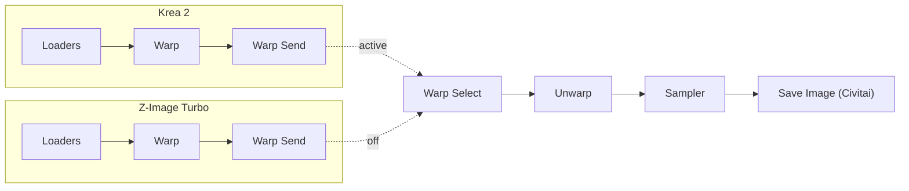

# Warp Studio

An all-in-one ComfyUI node suite that simplifies model management, streamlines workflows, and makes prompting easier.

It is WarpPipe and Civitai Updater in one package, for people who switch models a lot and like their LoRAs in the prompt.

- **Prompt + LoRAs**: LoRAs are tags in the text, and colours tell you what will load before you queue.
- **Prompt Writer**: an LLM chat behind every prompt box. Each answer is a version you can compare and send back.
- **Warp / Unwarp**: a whole generation in one wire.
- **Warp Send / Select**: switch between model groups without moving a wire.
- **Save Image (Civitai)**: metadata Civitai reads, so an upload credits the right model and LoRAs.
- **Warp Studio panel**: a sidebar panel with a gallery of your LoRAs, a check for models with a newer release, and a rename into one scheme.

## Install

```bash
comfy node install warp-studio
```

Or clone `https://github.com/gregory-richard/ComfyUI-WarpStudio` into `ComfyUI/custom_nodes`, run `pip install -r requirements.txt` with ComfyUI's Python, and restart. Python 3.9+. The registry installs the requirements for you.

## Coming from WarpPipe or Civitai Updater

1. Install Warp Studio.
2. Update the old package in the Manager, or disable it there. The old and new packages must not both be active: while WarpPipe before 5.1.0 or Civitai Updater before 1.10.0 is still active, Warp Studio switches itself off, with a message, until the old one is updated or disabled.
3. Restart ComfyUI. Your settings, chats, API keys, hashes and the updater's data are copied once into `ComfyUI/user/warp-studio/`. The old files stay where they were.

Don't uninstall Civitai Updater until Warp Studio has started once: your updater data lives in its folder and is copied on that first start.

Nothing looks different: the nodes, the Prompt Writer, the LoRA browser and the updater panel work as before. The panel is now called **Warp Studio**. Settings now sit under **Warp Studio** in ComfyUI's settings, and the updater's groups read "Civitai Network", "Civitai General" and so on. The HTTP routes start with `/warp-studio/`.

## Prompt + LoRAs


The prompt goes on top, the LoRAs in the list below, one per line:

```text
//// Subject
a red bicycle leaning on a stone wall by a lake, early morning mist
soft window light, film grain
//// Style
// a note: never reaches the model
35mm photo, muted colours <lora:old-polaroid:0.5>
```

```text
<lora:film-grain-xl:0.8>
<lora:window-light:0.6>
// <lora:watercolor-wash:0.5>
```

| Colour | Means |
| --- | --- |
| cyan | the LoRA was found |
| red | no file by that name |
| orange | made for another base model |
| green | trigger word of a LoRA that is on (dim when it is off) |
| grey | a `//` note, or a LoRA switched off |

`////` starts a section you can fold. `/` completes from your LoRA library, `Tab`
on a tag adds its trigger words, `Ctrl+/` switches lines on and off. A second
list can feed `model_2` for two-pass setups.

## Prompt Writer


Click **✨ AI Prompt Writer** above any prompt box and say what you want, with
reference images if you like. Every answer becomes a version. Edit it, use it as
the input for the next one, retry or recreate it, or **Send to ComfyUI**.
**Changes** marks what is new and puts the word it replaced small above it, and
each version's **Generation info** shows its request, the prompt it edited, the
model and settings, the system prompt, the cost and the thinking.

- Works with NanoGPT out of the box, or any OpenAI-compatible server (LM Studio, Ollama, llama.cpp).
- The API key stays on the ComfyUI server (`user/warp-studio/llm_keys.json` or `NANOGPT_API_KEY`). It never reaches the browser, a workflow or an image.
- Bring your own system prompts: a folder of `.txt` files, set under Settings → Warp Studio.
- It knows your LoRAs for the connected model and can suggest some. Nothing lands in your list until you press **+**.
- Chats are saved in the ComfyUI user folder and keep writing after you close the pop-up.

## One wire


A **Warp** takes models, conditioning, latents, prompts and sampler settings. One
link crosses the canvas, and an **Unwarp** gives it all back. Warps chain: one
further down carries everything the first did and adds to it.

## Switching model groups




Put a **Warp Send** at the end of each model group and one **Warp Select** in the
shared part. Press **activate** on a Send, or pick it in the Select, and only that
group runs. Green runs, red doesn't. If the routing is broken (nothing active, the
active Send muted, two Sends with one name) the queue says so instead of running.

The active Send shows the live preview while it samples
(`--preview-method auto`) and a before/after slider when it is done. Right-click
any image node and **Use as before image** to choose what goes on the left. The
same slider exists as its own node, **Warp Compare**.

## Save Image (Civitai)

Saves PNG or JPEG with the generation info Civitai reads. The `Hashes` field is
what makes an upload link the checkpoint and every LoRA:

```text
a red bicycle by a lake, early morning mist <lora:film-grain-xl:0.8>
Steps: 30, Sampler: dpmpp_2m, Schedule type: karras, CFG scale: 5.0, Seed: 44,
Size: 1024x1024, Model hash: 4c2b8e1f0a, Model: demo-sdxl,
Lora hashes: "film-grain-xl: 3b1f0c2a9d",
Hashes: {"model":"4c2b8e1f0a","lora:film-grain-xl":"3b1f0c2a9d"}, Version: ComfyUI-WarpPipe
```

It also shows what it saved next to the before image, in the same slider.

Trigger words, base models and titles come from the `.civitai.info` files next to your models.
The **Warp Studio** panel (below) shows the same library as a gallery. **Browse LoRAs** on the node opens it.

## Warp Studio panel

The **Warp Studio** tab in ComfyUI's sidebar holds your model library. It has
a Gallery of your LoRAs, a check of your models against their Civitai releases,
and a rename for your files.

### Gallery

Your LoRAs as cards with their previews. Search by name, creator or version, and
filter by type or base model. A line under the search says which Prompt + LoRAs
node a click adds to: the selected one, or else the last one you used. Click a
card and its tag is written into that node, and the card says **Added**.

**Browse LoRAs** on a Prompt + LoRAs node opens the panel on the Gallery with
that node as the target.

### Updates, Issues and Rename

The other tabs check the models on your disk against their Civitai releases and
list the ones that have moved on without you.

It identifies each file by its SHA256 hash, reads the `.civitai.info` files you
already have, and writes only `.civitai.info` and `.preview.png` files next to
your models. Checking downloads no model; a card links you to the release page.

Three more views sit above the list:

- **Updates**: models with a release newer than your newest local version. A card is a ledger of that model's releases, one row per version. Red means one thing: a release exists that you do not have. A **Buzz** badge marks a release that costs Buzz.
- **Issues**: files Civitai had no release for (a merge, a conversion, a file never uploaded) or could not be asked about (removed, needs an API key). The reason is under each row.
- **Rename**: see below.

**Check for Updates** scans and compares. **Fetch Missing Metadata** only
downloads sidecars and previews for models that lack them. Both can be paused,
resumed and stopped, and survive a page reload. **Arrange** groups the list by
model type and base model and sorts it. Any release you don't want can be hidden.

The API key, cache time, extra model folders and how mature models show are in
the settings, under **Warp Studio** in the groups that start with "Civitai".

### Previews from other sources

Some models Civitai no longer serves. For those files, **Fetch Missing Metadata**
can ask other sources, in order, and the first answer wins:

- **ai-toolkit**: your own trainings. Point it at the folders that hold your runs and their sample images become previews.
- **Hugging Face**: authors or repos you name, matched by file hash.
- **civarchive**: looked up by hash. Only the hash is sent.

A hit writes a preview and fills only the empty fields of the info file. It
never replaces a preview you have, and never changes a file that Civitai
identifies. The row says the file was found elsewhere. The sources are set under
**Civitai Preview Fallback** in the settings; civarchive is off until you turn
it on.

### Renaming your library

The **Rename** view renames your model files after their current Civitai
releases, in one scheme, all lowercase:

```text
creator - title - version [precision] (base)
some_artist - watercolor style - v2 (sdxl)
some_studio - photo mix - v3 fp16 (sdxl)
```

A local text model cleans the names. ComfyUI's own **Generate Text** node runs it
through the queue, and nothing goes to the cloud. Pick it under **Civitai
Rename** in the settings, or let the view download one (9.75 GB).

1. **Start dry run** lists every old name next to its new one. Nothing on disk changes.
2. **Review.** Rows that need a look come first and start unticked: a word that is not in Civitai's text, two files with one name, a new base code. Edit any part, or **Ask again**. Files Civitai can't serve, named from the info the preview fallback found, start unticked too.
3. **Apply.** The button says what it will do, as in **Rename 12 · remove 2**, and asks once; **Apply** then renames the ticked rows, together with their `.civitai.info`, previews and any other file that shares the name. Extra copies go to the Recycle Bin.

The naming model gets about three in four names exactly right, so read the list.
A rename cut off by a crash can be finished or undone on the next start. Saved
workflows that use the old names will show those models as missing; re-pick
them. Every move is recorded in `ComfyUI/user/warp-studio/updater/rename_log.jsonl`.
What is never renamed, and the rest of the details, are in the
[wiki](WIKI.md#warp-studio-panel).

## Example workflow


Krea 2 and Z-Image Turbo in one workflow. The image below was made with it and
has the workflow inside: drag it into ComfyUI to open it, or grab the
[JSON](examples/workflow_example.json).


## All nodes

| Node | |
| --- | --- |
| 🌀 Warp / Unwarp | Bundle a generation into one link and unpack it again |
| 🌀 Warp Provider | Latent and sampler settings, with size presets for current models |
| 🌀 Prompt + LoRAs | Prompt and LoRAs in one box |
| 🌀 Save Image (Civitai) | Save with metadata Civitai reads |
| 🌀 Warp Send / Warp Select | Pick which model group runs |
| 🌀 Warp Compare | Before/after slider |
| 🌀 Scheduler Adapter for FaceDetailer | KSampler schedulers for FaceDetailer |
| 🚫 Dead End | Takes anything, does nothing. Parks a branch |

The **Warp Studio** sidebar panel is not a node; it is described above.

Each node has its own help behind the `?` in ComfyUI. Everything else, every
input and the HTTP routes are in the **[wiki](WIKI.md)**. What changed, release by
release, is in the [changelog](CHANGELOG.md).

## Credits

Screenshots use demo LoRAs and stand-in images, not anyone's real models. The
Warp Studio panel builds on ideas from
[Stable-Diffusion-Webui-Civitai-Helper](https://github.com/zixaphir/Stable-Diffusion-Webui-Civitai-Helper).
Developed with AI assistance (GPT-5.3-Codex, Claude Opus 4.6, Claude Opus 5).
[MIT License](LICENSE).
