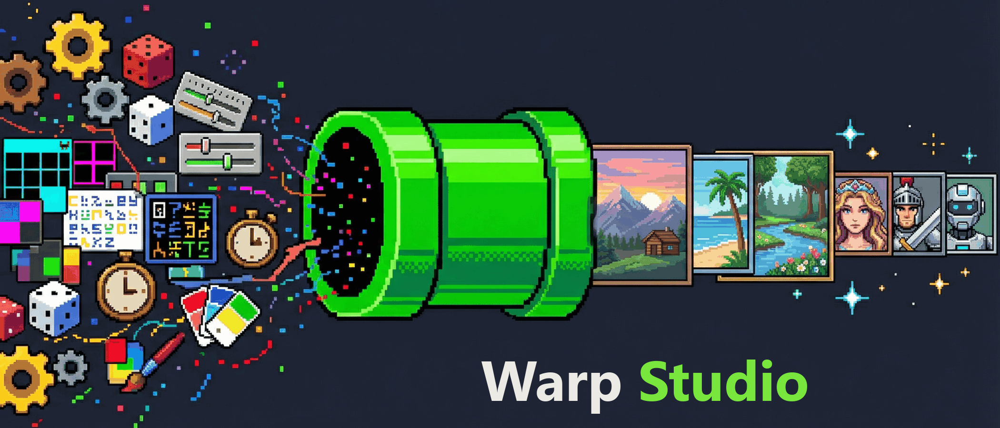
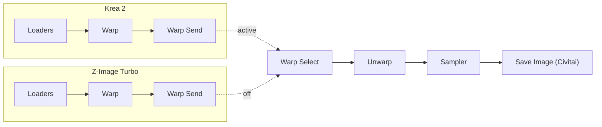

# Warp Studio

An all-in-one ComfyUI node suite that simplifies model management, streamlines workflows, and makes prompting easier.

It is WarpPipe and Civitai Updater in one package, for people who switch models a lot and like their LoRAs in the prompt.

- **Prompt + LoRAs**: LoRAs are tags in the text, and colours tell you what will load before you queue.
- **Prompt Writer**: an LLM chat behind every prompt box. Each answer is a version you can compare and send back.
- **Warp / Unwarp**: a whole generation in one wire.
- **Warp Send / Select**: switch between model groups without moving a wire.
- **Save Image (Civitai)**: metadata Civitai reads, so an upload credits the right model and LoRAs.
- **Warp Studio panel**: a sidebar panel with a gallery of your LoRAs, a check for models with a newer release, and a rename into one scheme.

## Install

```bash
comfy node install warp-studio
```

Or clone `https://github.com/gregory-richard/ComfyUI-WarpStudio` into `ComfyUI/custom_nodes`, run `pip install -r requirements.txt` with ComfyUI's Python, and restart. Python 3.9+. The registry installs the requirements for you.

## Coming from WarpPipe or Civitai Updater

1. Install Warp Studio.
2. Update the old package in the Manager, or disable it there. The old and new packages must not both be active: while WarpPipe before 5.1.0 or Civitai Updater before 1.10.0 is still active, Warp Studio switches itself off, with a message, until the old one is updated or disabled.
3. Restart ComfyUI. Your settings, chats, API keys, hashes and the updater's data are copied once into `ComfyUI/user/warp-studio/`. The old files stay where they were.

Don't uninstall Civitai Updater until Warp Studio has started once: your updater data lives in its folder and is copied on that first start.

The nodes, the Prompt Writer and the updater work as before. **Browse LoRAs** now opens the Gallery in the sidebar panel instead of a pop-up, and the panel is now called **Warp Studio**. Settings now sit under **Warp Studio** in ComfyUI's settings, and the updater's groups read "Civitai Network", "Civitai General" and so on. The HTTP routes start with `/warp-studio/`.

## Prompt + LoRAs


The prompt goes on top, the LoRAs in the list below, one per line:

```text
//// Subject
a red bicycle leaning on a stone wall by a lake, early morning mist
soft window light, film grain
//// Style
// a note: never reaches the model
35mm photo, muted colours <lora:old-polaroid:0.5>
```

```text
<lora:film-grain-xl:0.8>
<lora:window-light:0.6>
// <lora:watercolor-wash:0.5>
```

| Colour | Means |
| --- | --- |
| cyan | the LoRA was found |
| red | no file by that name |
| orange | made for another base model |
| green | trigger word of a LoRA that is on (dim when it is off) |
| grey | a `//` note, or a LoRA switched off |

`////` starts a section you can fold. `/` completes from your LoRA library, `Tab`
on a tag adds its trigger words, `Ctrl+/` switches lines on and off. A second
list can feed `model_2` for two-pass setups.

## Prompt Writer


Click **✨ AI Prompt Writer** above any prompt box and say what you want, with
reference images if you like. Every answer becomes a version. Edit it, use it as
the input for the next one, retry or recreate it, or **Send to ComfyUI**.
**Changes** marks what is new and puts the word it replaced small above it, and
each version's **Generation info** shows its request, the prompt it edited, the
model and settings, the system prompt, the cost and the thinking.

- Works with NanoGPT out of the box, or any OpenAI-compatible server (LM Studio, Ollama, llama.cpp).
- The API key stays on the ComfyUI server (`user/warp-studio/llm_keys.json` or `NANOGPT_API_KEY`). It never reaches the browser, a workflow or an image.
- Bring your own system prompts: a folder of `.txt` files, set under Settings → Warp Studio.
- It knows your LoRAs for the connected model and can suggest some. Nothing lands in your list until you press **+**.
- Chats are saved in the ComfyUI user folder and keep writing after you close the pop-up.

## One wire


A **Warp** takes models, conditioning, latents, prompts and sampler settings. One
link crosses the canvas, and an **Unwarp** gives it all back. Warps chain: one
further down carries everything the first did and adds to it.

## Switching model groups




Put a **Warp Send** at the end of each model group and one **Warp Select** in the
shared part. Press **activate** on a Send, or pick it in the Select, and only that
group runs. Green runs, red doesn't. If the routing is broken (nothing active, the
active Send muted, two Sends with one name) the queue says so instead of running.

The active Send shows the live preview while it samples
(`--preview-method auto`) and a before/after slider when it is done. Right-click
any image node and **Use as before image** to choose what goes on the left. The
same slider exists as its own node, **Warp Compare**.

## Save Image (Civitai)

Saves PNG or JPEG with the generation info Civitai reads. The `Hashes` field is
what makes an upload link the checkpoint and every LoRA:

```text
a red bicycle by a lake, early morning mist <lora:film-grain-xl:0.8>
Steps: 30, Sampler: dpmpp_2m, Schedule type: karras, CFG scale: 5.0, Seed: 44,
Size: 1024x1024, Model hash: 4c2b8e1f0a, Model: demo-sdxl,
Lora hashes: "film-grain-xl: 3b1f0c2a9d",
Hashes: {"model":"4c2b8e1f0a","lora:film-grain-xl":"3b1f0c2a9d"}, Version: ComfyUI-WarpPipe
```

It also shows what it saved next to the before image, in the same slider.

Trigger words, base models and titles come from the `.civitai.info` files next to your models.
The **Warp Studio** panel (below) shows the same library as a gallery. **Browse LoRAs** on the node opens it.

## Warp Studio panel

The **Warp Studio** tab in ComfyUI's sidebar holds your model library. It has
a Gallery of your LoRAs, a check of your models against their Civitai releases,
and a rename for your files.

### Gallery

Your LoRAs as cards with their previews, in bands by base model. A switch at
the top picks **LoRAs**, **Models** or **Embeddings**; a type with no files is
not offered, and the last one you used is remembered. A card shows the creator,
title and version from the file name when it follows `creator - title - version
(base)`; otherwise Civitai's model name, then the file name.

The toolbar has 🔍, **Filter** and **Sort**. 🔍 opens the search, which matches
name, creator, version and Civitai's model name, and stays lit while it holds
text. **Filter** narrows by base model. **Sort** groups by base or not at all
and orders by name, by what is newest on disk, or by Civitai's numbers: **Most
downloaded**, **Most liked** or **Most comments**. Those come from the last
Check for Updates, and each card then shows its number. Models Civitai has no
numbers for come last. A base band folds when you
click its header, and stays folded after a reload. The band that matches the
model wired into the target node is marked **for this workflow** and comes
first; it follows you when you switch workflows.

A card is one Civitai model on one base. When you have several versions of it,
a **n versions ▾** chip lists them, and the one you pick is the one the card
acts for.

A click acts on the Prompt + LoRAs node you selected, or else the last one you
used. A line shows only when there is nothing to act on: **Select a Prompt +
LoRAs node**, or **No Prompt + LoRAs node in this workflow**.

- **LoRAs:** the first click adds `<lora:name:1.00>` as a new line at the end of
  the node's LoRA list. A ✓ on the card says it is on. The next click parks it
  as `// <lora:…>`, with a hollow mark. The next switches it on again. A click
  never deletes a line, and the marks follow the list when you edit it by hand.
  The second-pass list gets the LoRA only when it is switched on and was the last
  list you typed in.
- **Models:** a click sets the model of the selected Load Checkpoint or Load
  Diffusion Model node. The card of the model it loads has a ✓.
- **Embeddings:** a click adds `embedding:name` to the node's prompt, once.

**Include downloadable** in **Filter**, offered only when some LoRAs have an info
file here but no weights, shows them as dimmed cards. **Download** on one fetches
the version its info file describes and puts it next to that file, under the same
name. On the other cards, **Delete**
turns into **Delete?** for four seconds; click again and the weights and their
info and preview go to the Recycle Bin. On a drive without a Recycle Bin, or for a file
too big for it, Windows deletes the file for good. Without `send2trash`, Delete is not offered.

**Browse LoRAs** on a Prompt + LoRAs node opens the panel on the Gallery with
that node as the target.

### Updates, Issues and Rename

The other tabs check the models on your disk against their Civitai releases and
list the ones that have moved on without you. The ⚙ in the panel's header holds
the settings for it: model scope, **Force rehash**, **Refetch metadata** and the
resolved roots.

It identifies each file by its SHA256 hash, reads the `.civitai.info` files you
already have, and writes only `.civitai.info` and `.preview.png` files next to
your models. Checking downloads no model; a download starts only when you click
**Download**, and a file moves only when you click **Archive** or **Unarchive**.

Three more views sit above the list:

- **Updates**: models with a release newer than your newest local version. Red means one thing: a release exists that you do not have. A **Buzz** badge marks a release that costs Buzz.
- **Issues**: files Civitai had no release for (a merge, a conversion, a file never uploaded) or could not be asked about (removed, needs an API key). The card says why.
- **Rename**: see below.

Updates and Issues show cards like the Gallery's: a large picture with the type
and base, ↗ to Civitai, the creator, the title and Civitai's numbers. The creator
and title are yours, taken from your newest file named `creator - title - …`;
without one, they are Civitai's. Under the picture is one row per version, each
with its own small picture: the new releases, the files on this drive and in the
archive, and the ones you deleted. Hover, tap or tab to a row and the picture,
the base and the line over the picture switch to that version: **New · date · not
downloaded**, **Saved · date · file name**, **Archived · date · on Z:**, or in
Issues what is wrong with it. A card with more than one new release says **2
new** on its picture. No text wraps: a long one ends in "…", and its tooltip has
all of it.

A row for a file you have shows the version part of its name, such as
`v3 (krea2)`. A new release shows the name its file will get, such as
`night v4 (krea2)`. The check ends by naming each new release with the naming
model (see [Renaming your library](#renaming-your-library)): it keeps your
creator and title and picks only the version, and a code for a base you have no
code for yet. The button reads **Naming 3 of 25** meanwhile, and a pause holds
between two models. **Stop** ends only the naming: the check's results and the
names made so far stay. Names are kept per release, so a later check names only
what came out since, and a release you are not interested in is not named. The
first check names every new release at once, which can take several minutes.
Without a naming model, a row shows Civitai's version name and base.

Each row has two buttons, always in the same place:

| Row | Buttons |
| --- | --- |
| A new release | **Download** · **Not interested** (**Show again** on one you hid) |
| A release that costs Buzz | its **Buzz** badge · **Not interested** |
| A file on this drive | **Delete** · **Archive** |
| A file in the archive | **Delete** · **Unarchive** |
| A deleted file | none |

**Download** fetches the release under the name its row shows, into its base
model's folder, or beside the version you have. When that name is taken there,
the file keeps Civitai's name. A release that has no name yet is named by the AI
as it downloads; with no naming model set, it keeps Civitai's file name.

**Delete** asks once: click again within four seconds and the weights and their
info and preview go to the Recycle Bin. On a drive without a Recycle Bin, or for
a file too big for it, Windows deletes the file for good. A file in the archive
goes to that drive's recycle bin; a network drive without one deletes it for
good.

**Archive** and **Unarchive**, offered once an archive folder is set, move a
version between this drive and the archive, into the same folder on the other
side: `Lora\krea2` here is `Lora\krea2` there, made when it is missing. The
weights are copied and checked against the SHA-256 in their info file, the info,
preview and any other file of that name are copied beside them, and only then
do the originals go to the Recycle Bin. Nothing is overwritten or renamed: a
name already taken on the other side refuses the move. A failed or stopped move
leaves the original as it was. When the Recycle Bin refuses the original (ComfyUI
has the LoRA loaded), both copies stay and the row says so. Only a file with its
`.civitai.info` can be archived, since the archive check finds files by it. A
moved row says **Archived** or **Saved** until the next check, even after a
restart, and a deleted one says **Deleted**. A model you downloaded stays in
**Updates** until the next check too, with the new version marked
**Downloaded**, so you can try it and then remove the old one.

Downloads and moves run on the ComfyUI server, one at a time, so they carry on if
you close the tab. A click while another job runs says **Waiting for the check**
(or the dry run, the rename, the metadata fetch, the naming model download) and
starts by itself when that job ends; **Cancel** takes it out. Waiting ones are
kept in the server's memory, so restarting ComfyUI drops them and the running
one. The row's button becomes a ring that fills as the file comes in or is
copied and spins while it is checked, with **Stop** beside it; then the row
shows the version where it now is. The job bar ends with a line like "Done — 2
downloaded, 1 moved". Each file is checked by SHA-256 before it gets its name,
and nothing already there is overwritten.

Most adult models need a Civitai API key to download. Set it under **Warp Studio**
→ **Civitai Network** → **API Key**; it is sent only to Civitai, over https.

**Check for Updates** and a **⋯** menu sit at the top of **Updates** and
**Issues**. **Check for Updates** scans and compares; with fresh saved results it
asks first whether to check again. While a check runs the button is its
progress ("Checking 491 of 746", filling as it goes), the **⋯** beside it is
**Stop**, and the cards not re-checked yet are dimmed. The
**⋯** menu holds **Fetch Missing Metadata**, which only downloads sidecars and
previews for models that lack them, and, once an archive folder is set,
**Check with archive**. Other jobs can be paused, resumed and stopped in the pill
at the bottom, and every job survives a page reload. The toolbar has
**Filter** (types, bases, **Show hidden**), **Sort** (grouping, order, page
size) and ⓘ, which holds when it was last checked, the counts, "Changes
detected" and **Check again**. **Rename** has **Filter** only. The list stays
still while a check runs. A release you mark **Not interested** leaves the list
and is not offered again; with **Show hidden** it comes back with **Show again**.

**Check with archive** is for models you moved to another drive. Set the folder
under **Warp Studio** → **Civitai Path Sources** → **Archive Folder**. The check
runs as usual, then looks up every archived model too: about 7 minutes more for
1,100 of them. The check only reads the archive. An archived model whose new
version is out shows in **Updates** with its archived row, and **Download** puts
the new version on this drive. A version you have in the archive is never
offered as new. The same version on both drives is listed in **Issues** as
**Duplicate**, and an info file left on this drive for a model in the archive as
**Info only**; **Delete** on either row removes that copy. The results are kept
until the next **Check with archive**, so a plain check doesn't drop them, and
the ⓘ says when the archive was last checked. The archive folder can't be a
model folder, or lie inside or hold one.

The API key, cache time, extra model folders, the archive folder and how mature
models show are in the settings, under **Warp Studio** in the groups that start
with "Civitai".

### Previews from other sources

Some models Civitai no longer serves. For those files, **Fetch Missing Metadata**
can ask other sources, in order, and the first answer wins:

- **ai-toolkit**: your own trainings. Point it at the folders that hold your runs and their sample images become previews.
- **Hugging Face**: authors or repos you name, matched by file hash.
- **civarchive**: looked up by hash. Only the hash is sent.

A hit writes a preview and fills only the empty fields of the info file. It
never replaces a preview you have, and never changes a file that Civitai
identifies. The row says the file was found elsewhere. The sources are set under
**Civitai Preview Fallback** in the settings; civarchive is off until you turn
it on.

### Renaming your library

The **Rename** view renames your model files after their current Civitai
releases, in one scheme, all lowercase:

```text
creator - title - version [precision] (base)
some_artist - watercolor style - v2 (sdxl)
some_studio - photo mix - v3 fp16 (sdxl)
```

A local text model cleans the names. ComfyUI's own **Generate Text** node runs it
through the queue, and nothing goes to the cloud. Pick it under **Civitai
Rename** in the settings, or let the view download one (9.75 GB).

1. **Start dry run** lists every old name next to its new one. Nothing on disk changes.
2. **Review.** Rows that need a look come first and start unticked: a word that is not in Civitai's text, two files with one name, a new base code. Edit any part, or **Ask again**. Files Civitai can't serve, named from the info the preview fallback found, start unticked too.
3. **Apply.** The button says what it will do, as in **Rename 12 · remove 2**, and asks once; **Apply** then renames the ticked rows, together with their `.civitai.info`, previews and any other file that shares the name. Extra copies go to the Recycle Bin.

The naming model gets about three in four names exactly right, so read the list.
A rename cut off by a crash can be finished or undone on the next start. Saved
workflows that use the old names will show those models as missing; re-pick
them. Every move is recorded in `ComfyUI/user/warp-studio/updater/rename_log.jsonl`.
What is never renamed, and the rest of the details, are in the
[wiki](WIKI.md#warp-studio-panel).

## Network and privacy

Warp Studio talks to the internet only for the features below, and only to these hosts:

| Feature | Goes to | What is sent |
| --- | --- | --- |
| Updates, metadata, previews | Civitai (`civitai.com`, `civitai.red`) | Your files' SHA-256 hashes and the Civitai ids in their info files. Your Civitai API key, if you set one, goes to Civitai and nowhere else |
| Downloads | Civitai, then the public https download host it redirects to | The file request. The key is dropped when the redirect leaves Civitai, and every file is checked against Civitai's SHA-256 |
| Previews from other sources (off until you set them up) | `huggingface.co`, `*.hf.co`, `civarchive.com`, `c.genur.art` | Hashes, and the author or repo names you entered |
| Prompt Writer | The AI provider in your settings: NanoGPT, a server on this computer, or a provider you saved a key for under ⚙ | Your idea, the chat so far, the LoRAs you picked, the system prompt (a `.txt` from the folder you set) and the pictures you attach. Pictures come only from ComfyUI's input, output and temp folders. A key goes only to the host it was saved for. Plain http only to this computer |
| Renaming, and naming new releases | Nothing: it runs a local model through ComfyUI's own queue | |

On your computer, Warp Studio reads, moves and deletes files only inside
ComfyUI's model folders, the extra folders you added and the archive folder, and
Delete sends them to the Recycle Bin. **Check with archive** only reads the
archive, for its `.civitai.info` files. The archive is written to only when you
click **Archive**, **Unarchive** or **Delete** on a row: a version is copied in
or out and checked by SHA-256 before its original goes to the Recycle Bin, and
Delete sends a file there to that drive's recycle bin. Nothing there is renamed.
**Show in
folder** works only in a browser on the computer ComfyUI runs on. Every route
but the thumbnail asks for a header that only the ComfyUI page sends, and refuses
requests from other sites. That holds for ordinary web pages, not for a DNS
rebinding attack, which ComfyUI's own server doesn't stop either. ComfyUI has no
login, so keep it off the internet. The details are in the
[wiki](WIKI.md#http-api).

## Example workflow


Krea 2 and Z-Image Turbo in one workflow. The image below was made with it and
has the workflow inside: drag it into ComfyUI to open it, or grab the
[JSON](examples/workflow_example.json).


## All nodes

| Node | |
| --- | --- |
| 🌀 Warp / Unwarp | Bundle a generation into one link and unpack it again |
| 🌀 Warp Provider | Latent and sampler settings, with size presets for current models |
| 🌀 Prompt + LoRAs | Prompt and LoRAs in one box |
| 🌀 Save Image (Civitai) | Save with metadata Civitai reads |
| 🌀 Warp Send / Warp Select | Pick which model group runs |
| 🌀 Warp Compare | Before/after slider |
| 🌀 Scheduler Adapter for FaceDetailer | KSampler schedulers for FaceDetailer |
| 🚫 Dead End | Takes anything, does nothing. Parks a branch |

The **Warp Studio** sidebar panel is not a node; it is described above.

Each node has its own help behind the `?` in ComfyUI. Everything else, every
input and the HTTP routes are in the **[wiki](WIKI.md)**. What changed, release by
release, is in the [changelog](CHANGELOG.md).

## Credits

Screenshots use demo LoRAs and stand-in images, not anyone's real models. The
Warp Studio panel builds on ideas from
[Stable-Diffusion-Webui-Civitai-Helper](https://github.com/zixaphir/Stable-Diffusion-Webui-Civitai-Helper).
Developed with AI assistance (GPT-5.3-Codex, Claude Opus 4.6, Claude Opus 5).
[MIT License](LICENSE).
